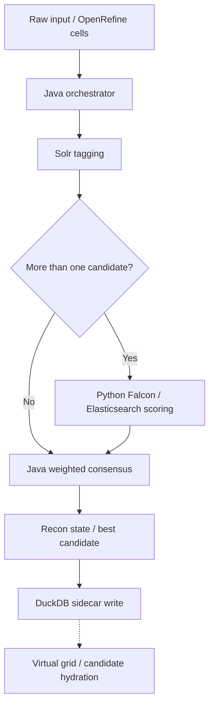

# SenTient architecture and implementation map

**Snapshot reviewed:** October 27, 2026  
**Declared version:** `1.0.0-RC3` (configuration/package metadata)  
**Verified status:** Multiple layer implementations are present in source; the integrated system is **not verified complete**.

## Purpose

SenTient aims to reconcile textual mentions with Wikidata/Wikibase entities while preserving candidate evidence and allowing human review. Its hybrid design combines Solr/OpenTapioca candidate discovery, a Python contextual scorer, Java adjudication, and a DuckDB sidecar.

## Intended flow

**Diagram qualification:** this is the intended design, **not a successfully executed trace**. The Java Solr response parser is still a stub, the servlet's application command handlers are not registered, and the UI build is not demonstrated in the snapshot.

## Components and evidence

| Layer | Source | Observable behavior | Open issue |
| --- | --- | --- | --- |
| Candidate retrieval | `server/solr/`, `opentapioca/`, Java orchestrator | Solr core/config and async request code are present | `parseSolrResponse` returns an empty list; integration not proven |
| Context scoring | `src/main.py`, `config/nlp/falcon_settings.yaml` | Flask handlers, ES lookups, embedding similarity, ranked JSON | Requires model download/available indexes; no measured service readiness |
| Consensus | `modules/core/src/com/google/refine/SenTientOrchestrator.java` | Weighted scoring and judgment branches in source | Integration depends on candidate parsing and valid HTTP URLs |
| Persistence | `modules/core/src/com/google/refine/storage/DuckDBStore.java` | Schema, insert, retrieval and feedback methods exist | No verified Java/DB integration or runtime tests supplied |
| UI | `src/components/` | Confidence bar and virtual list source files | Missing complete frontend entry/build in snapshot |
| Contracts | `schemas/` | JSON Schema documents exist | Logical `SmartCell` differs from compact Java `Cell` serialization |

## Scoring in Java

`SenTientOrchestrator.java` uses weighted components: Solr popularity **0.40**, Falcon context **0.30**, and Levenshtein score **0.30**. It selects `Matched` for a winning score at least **0.85**, `Ambiguous` for at least **0.40**, and `None` otherwise. These are source-code branches, **not validated accuracy measures**.

The older architectural aspirations of **precision >0.85**, **recall >0.80**, and sub-second performance are goals only; no reproducible evidence accompanies this snapshot. The label `1.0.0-FINAL` previously used in this blueprint was not a verified release status and has been removed.

## Further reading

- [Ingestion and tagging](01_INGESTION_LAYER.md)
- [Falcon semantic service](02_SEMANTIC_LAYER.md)
- [Java core and sidecar](03_CORE_LAYER.md)
- [Data dictionary](04_DATA_DICTIONARY.md)
- [Configuration](05_WIRING_AND_CONFIG.md)
- [API and frontend](06_API_AND_FRONTEND.md)
- [QA and validation](07_QA_AND_VALIDATION.md)
